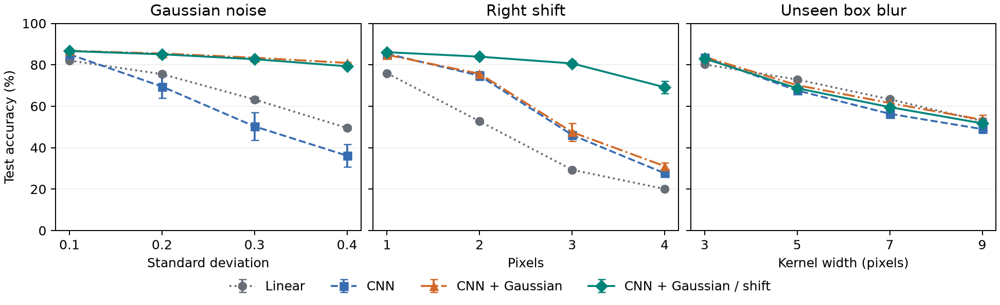
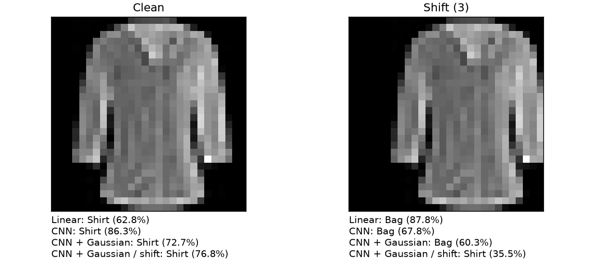
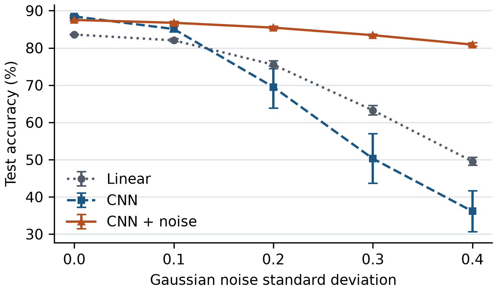

# Fashion-MNIST Corruption Robustness

An ENEL 645 deep learning project that measures how Gaussian noise and small image shifts affect clothing classification on Fashion-MNIST. It compares a linear classifier, a compact convolutional neural network (CNN), and the same CNN trained with Gaussian noise augmentation.

## Extended robustness benchmark

Does training on both noise and spatial shifts improve average performance across corruptions? The extended benchmark uses the same CNN architecture, initialization seeds, clean validation split and selection rule, optimizer, and eight-epoch training budget. The new policy uses 50% clean inputs, 25% Gaussian noise (σ = 0.3), and 25% horizontal shifts sampled from ±1, ±2, and ±3 pixels. Each image receives at most one corruption.

On the official 10,000-image test split, all four models see the same clean images and the same 12 corrupted conditions. Gaussian σ ranges from 0.1 to 0.4. Right shifts range from 1 to 4 pixels with zero fill. Box blur uses zero-padded kernels of width 3, 5, 7, and 9 pixels. Blur is held out from training and model selection.

| Model | Clean | All corruptions | Gaussian | Right shift | Held-out blur | Worst condition |
| --- | ---: | ---: | ---: | ---: | ---: | ---: |
| Linear | 83.59% | 59.80% | 67.58% | 44.51% | 67.32% | 20.05% |
| CNN | 88.46% | 60.94% | 60.25% | 58.45% | 64.13% | 27.64% |
| CNN + Gaussian | 87.53% | 70.38% | 84.14% | 59.75% | 67.25% | 31.08% |
| CNN + Gaussian and shift | 87.59% | 76.38% | 83.43% | 79.96% | 65.75% | 51.74% |

Family accuracy averages the four severities per seed before averaging the three seeds. **All corruptions** weights the three families equally and excludes clean inputs. **Worst condition** averages each seed’s minimum accuracy across the 12 corruptions. The chart shows mean ± sample standard deviation across training seeds.

Relative to the Gaussian-only CNN, mixed augmentation changed mean corruption accuracy by **+6.00 percentage points**. The family-level changes were +20.21 points for shifts, -0.71 for Gaussian noise, and -1.50 for held-out blur. Clean accuracy changed by +0.06 points. These numbers describe the tested synthetic conditions on Fashion-MNIST.

~~~powershell
.\.venv\Scripts\python.exe benchmark.py --output benchmark_reproduced
.\.venv\Scripts\python.exe -m unittest -v test_benchmark
~~~

The benchmark retrains the mixed-augmentation CNN for all three seeds and evaluates it alongside the original checkpoints. [Per-run scores](benchmark_results/metrics.csv) cover all 156 evaluations, including macro-F1. The [summary and run settings](benchmark_results/summary.json) include per-family means, sample standard deviations, and training histories.

## Inspect a prediction under corruption

~~~powershell
.\.venv\Scripts\python.exe inspect_sample.py results/sample_shirt.png --family shift --severity 3 --output sample-comparison.png
~~~

This command compares the top prediction from all four models before and after corruption. It prints JSON and writes a side-by-side PNG. Pass a different image or use `--family gaussian` or `--family blur` to explore other conditions. The scores are uncalibrated softmax outputs.

This benchmark uses a custom Fashion-MNIST protocol inspired by [Hendrycks and Dietterich's corruption benchmark](https://arxiv.org/abs/1903.12261) and [AugMix's study of augmentation and robustness](https://arxiv.org/abs/1912.02781).

## Original experiment results

Mean test accuracy across three training seeds on the official 10,000-image test split.

| Model | Clean | Gaussian noise (σ = 0.3) | 3-pixel right shift |
| --- | ---: | ---: | ---: |
| Linear classifier | 83.59% | 63.25% | 29.34% |
| CNN | **88.46%** | 50.28% | 46.12% |
| CNN with noise augmentation | 87.53% | **83.43%** | **47.48%** |

Adding Gaussian noise during training improved CNN accuracy by 33.15 percentage points at σ = 0.3, with a 0.93-point drop on clean images. Accuracy on the right-shift test rose by 1.36 points. The evaluation covers synthetic corruptions of grayscale catalog images.

## Setup on Windows

Open PowerShell in the repository folder. These commands use Python 3.12 and the CPU build of PyTorch.

~~~powershell
py -3.12 -m venv .venv
.\.venv\Scripts\python.exe -m pip install "torch==2.15.0" --index-url https://download.pytorch.org/whl/cpu
.\.venv\Scripts\python.exe -m pip install -r requirements.txt
~~~

## Predict with a trained model

~~~powershell
.\.venv\Scripts\python.exe predict.py results/sample_shirt.png
~~~

The script returns the three classes with the highest softmax scores. The sample's top prediction is `Shirt`, with a score of about 0.727. By default, it loads the noise-augmented CNN checkpoint for seed 11. Use `--checkpoint` to select a different checkpoint. For a dark foreground on a light background, pass `--invert`. Inputs work best when they resemble the centered garment crops in Fashion-MNIST.

## Reproduce the experiment

~~~powershell
.\.venv\Scripts\python.exe experiment.py --output reproduced
.\.venv\Scripts\python.exe figures.py --results reproduced
~~~

The first run downloads the official dataset and verifies the file checksums. It uses 55,000 images for training, 5,000 for validation, and 10,000 for testing. Each of the three models trains for eight epochs with seeds 11, 22, and 33. For each run, the script saves the checkpoint with the highest clean validation accuracy. It then evaluates that checkpoint on clean images, four Gaussian noise levels, and a three-pixel right shift.

These commands write to `reproduced/` so you can compare your run with the bundled results. Small numerical differences can occur across software versions or hardware.

## Repository contents

| Path | Contents |
| --- | --- |
| `experiment.py` | Dataset download, data splits, model training, and evaluation |
| `predict.py` | Single-image inference with a saved checkpoint |
| `figures.py` | Summary statistics and plots |
| `results/checkpoints/` | Nine checkpoints for three models and three seeds |
| `results/metrics.csv` | Accuracy and macro-F1 for all 54 evaluations |
| `results/experiment.json` | Run settings, validation histories, and confusion matrices |
| `results/summary.json` | Means and sample standard deviations across training seeds |
| `results/*.png` | Experiment plots and the sample inference image |

[Official Fashion-MNIST dataset](https://github.com/zalandoresearch/fashion-mnist)
